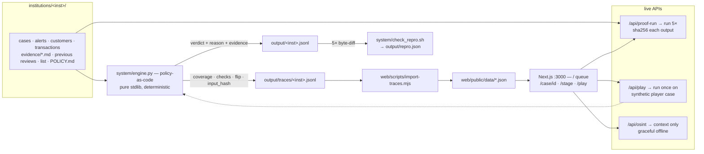
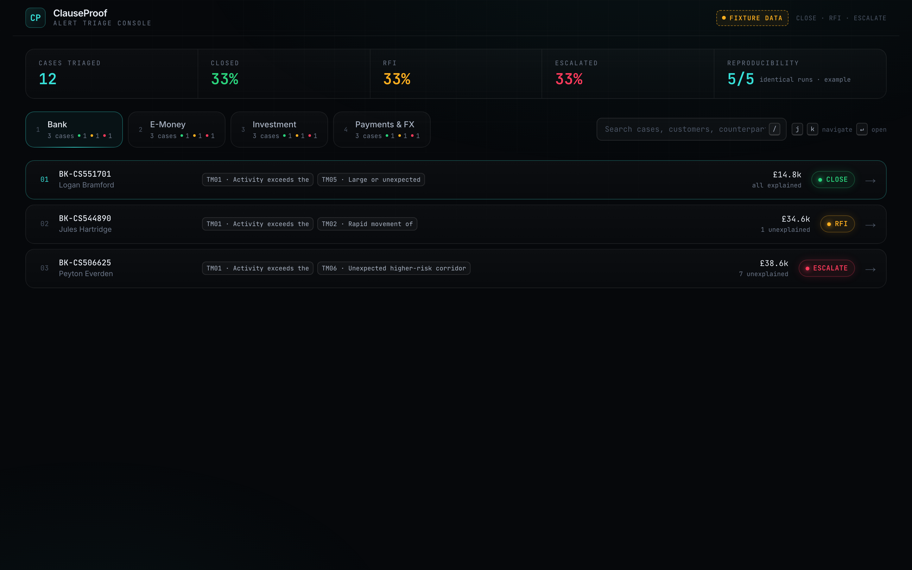
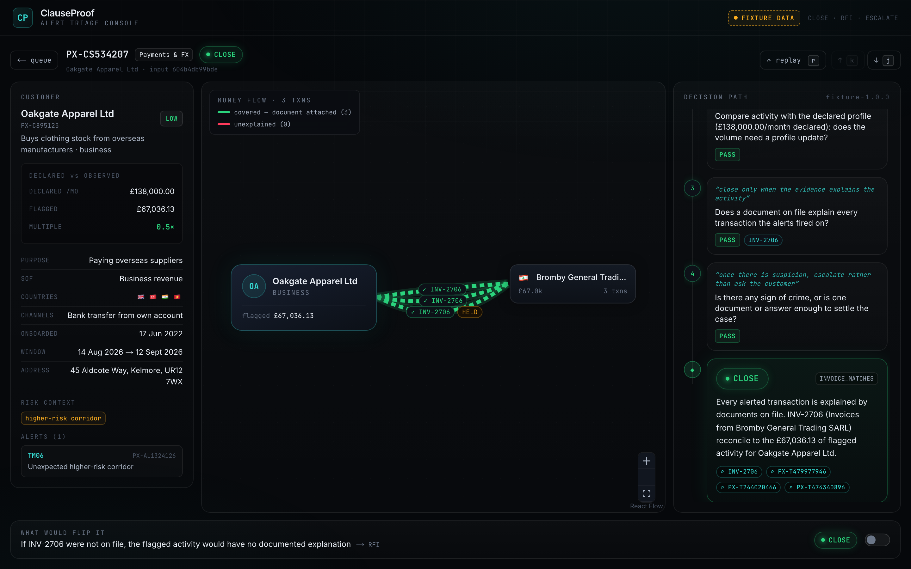
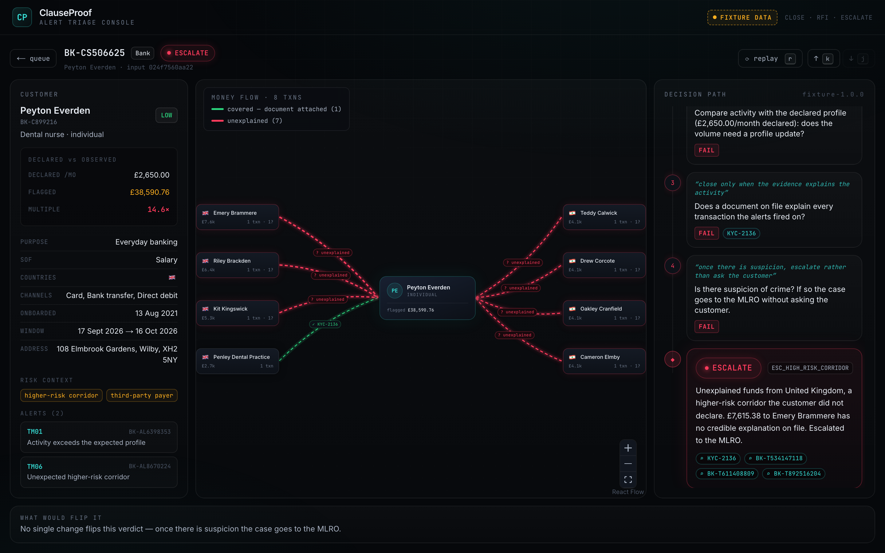
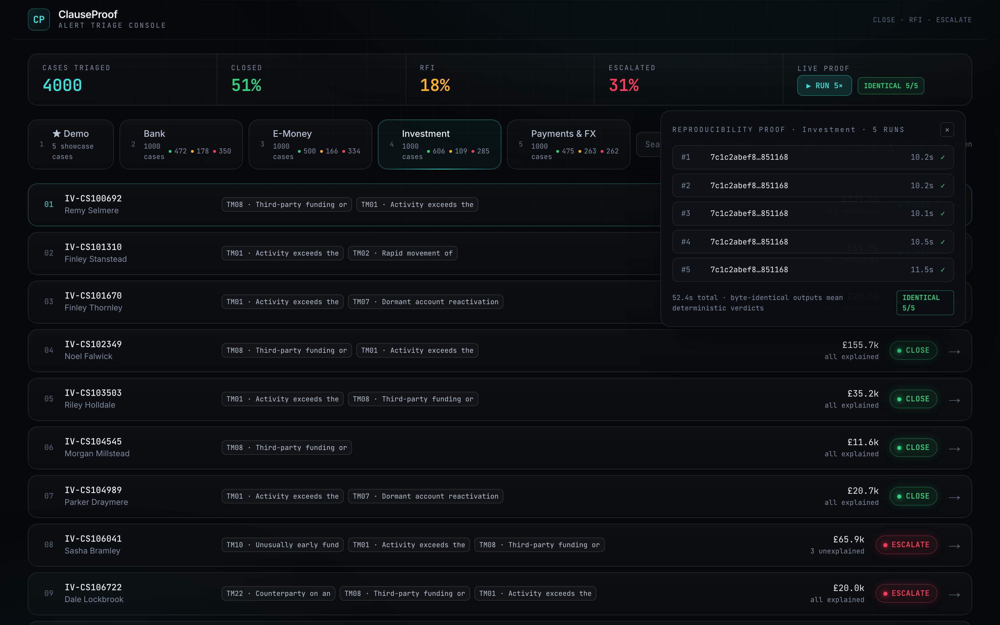
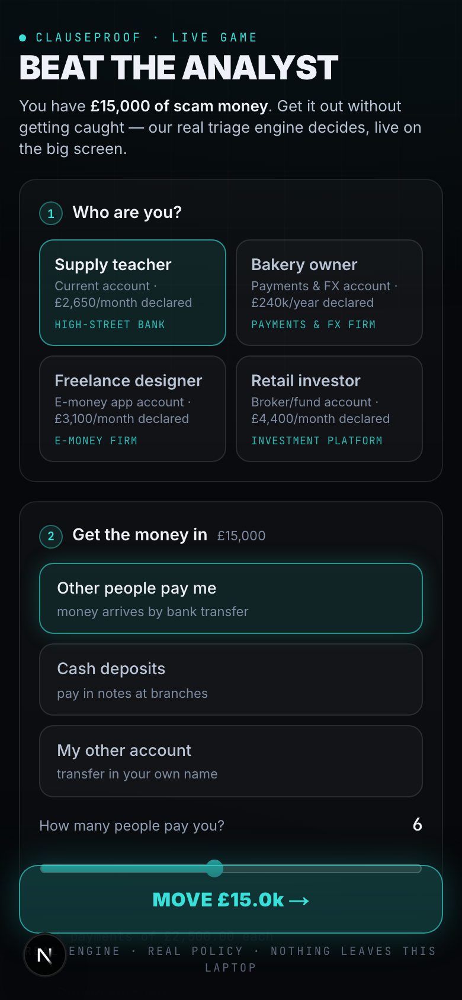
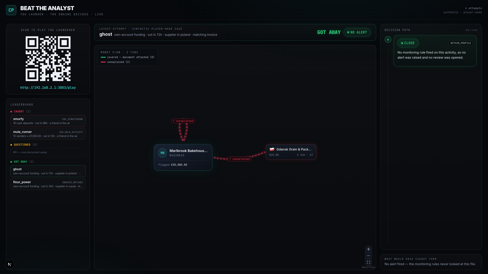

# ClauseProof

Transaction-monitoring alert triage, built for the London Financial Crime
Hackathon (Track 1). ClauseProof reads one institution's alerts, customer
profiles, transactions, evidence documents, earlier reviews and internal
list — and decides for every case: **CLOSE**, **RFI** (ask the customer for
one specific thing) or **ESCALATE** to the MLRO — with a `reason_code`, a
2–4 sentence reason naming the exact facts relied on, and the evidence IDs.

## For judges — start here

**Web app (no install):** https://clauseproof-c1gd.onrender.com
(free hosting: the first load after it has been idle can take about 30 seconds.)

- **`/run` — test your own dataset.** Zip one institution folder (POLICY.md, alerts, cases, customers, transactions, evidence, internal_list, previous_reviews), upload it, and the app runs `system/run` 5 times, shows the SHA-256 of each output (IDENTICAL when they match), runs `system/validate.py`, and lets you download the output JSONL.
- **`/live`** — describe a scenario in plain English and the real engine decides it against the real policy.
- **`/play` + `/stage`** — Beat the Analyst: invent a laundering scheme on your phone, watch the verdict on the big screen.
- **`/` and `/queue`** — the analyst case queue, with policy-quoted reasoning for every case.

**Command line (official contract, Python 3 stdlib only, no pip install):**

```bash
git clone https://github.com/Riyu-D1/ClauseProof && cd ClauseProof
system/run /path/to/institutions/bank /tmp/bank.jsonl      # one institution per call
python3 system/validate.py /path/to/institutions/bank /tmp/bank.jsonl
```

Each output line is one case:
`{"case_id", "alert_ids", "verdict": "CLOSE|RFI|ESCALATE", "reason_code", "reason", "evidence"}`.
Run it as many times as you like; the output file is byte-identical every time
(`shasum -a 256` to check). `system/run` reads only the folder it is given and
writes only its output file (plus its own cache inside `system/`).

**Grok:** off by default, so the verdicts come from the deterministic engine alone.
With `--grok` Grok reads unstructured documents
such as prose purchase orders at temperature 0 with a fixed seed. Its answers are
cached by input hash, and committed fixtures live in `system/grok_fixtures/`.
Grok never decides a verdict, so repeat runs stay byte-identical.

## Why it is different

- **Deterministic policy-as-code.** The engine is pure Python 3 stdlib — no
  LLM in the decision, no randomness, no clock, sorted iteration everywhere. Five runs of 800
  unseen cases produce byte-identical output; `system/check_repro.sh` proves
  it 5× per institution, and the app re-proves it live.
- **Explain-every-pound coverage.** For every alerted transaction the engine
  emits a coverage row: which document explains it (amount + payee + date
  matching), or exactly why it is unexplained. A case can only CLOSE when
  every pound is covered.
- **Policy-quoted decision path.** Each verdict carries an ordered list of
  checks — each one a quoted clause of that institution's `POLICY.md` with a
  PASS / FAIL / UNKNOWN result — so an analyst can audit the reasoning, not
  just the answer.
- **Counterfactual "flip" card.** For every case the engine re-runs the
  decision with one fact toggled (a document removed, a document added, a
  list match resolved) and reports what would change the verdict.
- **Beat the Analyst.** A live game: visitors invent a laundering scheme on
  their phone (`/play`), the real engine decides it against the real policy,
  and the big screen (`/stage`) shows the decision live. The scoreboard keeps
  CAUGHT / QUESTIONED / GOT AWAY.

## Quick start — one command

```bash
./start.sh          # checks deps → engine outputs → import → build → serve
./start.sh --tunnel # also opens a public tunnel for remote phones
```

Then open **http://localhost:3000**. The script prints the LAN URL for
`/play` (phones) and `/stage` (the big screen). It needs macOS/Linux with
`python3` and Node 18+; it reuses the engine output when the institution
inputs are unchanged (`input_hash` is verified, not assumed) and degrades
gracefully offline.

Smoke test the running app end to end:

```bash
./scripts/smoke.sh  # 18 checks: pages, queues, APIs, live 5× proof, 4 plays
```

## Live demo

**Public URL:** https://clauseproof-c1gd.onrender.com — open it on
a phone: `/` is the queue, `/play` is the game, `/stage` is the shared
scoreboard (game plays appear live via Supabase realtime).

The private dataset (`institutions/`, 4,000 cases) is **not** shipped — it is
gitignored and never enters the image. What the hosted build serves:

| Thing | Live or recorded? |
|---|---|
| `/` queue + `/case/<id>` boards | Recorded — pre-generated `web/public/data` + `output/traces` from real local runs |
| `/play` Beat the Analyst | **Live** — the real engine runs server-side on each synthetic player case; `demo/institutions/` (bundled, synthetic) supplies `POLICY.md` + `internal_list.jsonl` |
| `/stage` leaderboard | **Live** — plays are inserted into Supabase `public.plays`; every viewer sees inserts via realtime (falls back to in-memory polling if Supabase is unconfigured/down) |
| `POST /api/proof-run` | **Live** — real `system/run` ×5 with SHA-256 per output, on the bundled `demo/institutions/` subset (23 synthetic cases); labelled "demo subset" in the UI |
| `/api/evidence` docs | Partial — dataset evidence markdown is not shipped; demo-case docs resolve, dataset docs 404 gracefully |
| `output/repro.json` | Recorded run from local 5× proof (clearly labelled) |

`demo/institutions/` is generated from the game's own synthetic case
generator — nothing from the dataset except `POLICY.md` verbatim (safe to
ship). Regenerate with `cd web && npm run build:demo-inst`.

### Deploy on Render (free tier)

1. Push this branch and open `render.yaml` — it's a Blueprint: Render
   dashboard → **New → Blueprint** → connect the GitHub repo → apply. Or
   **New → Web Service** → same repo → Runtime: **Docker**, Plan: **Free**.
2. Set two env vars in the service's **Environment** tab (values live in
   `web/.env.local`; the publishable key is browser-safe by design — RLS
   guards the table):
   - `NEXT_PUBLIC_SUPABASE_URL`
   - `NEXT_PUBLIC_SUPABASE_PUBLISHABLE_KEY`
3. Deploy. Render injects `PORT`; the container's `next start` honours it.
   Without the env vars the app still runs — plays just stay in-memory.

### Run the image locally

```bash
docker build -t clauseproof .
docker run -p 3000:3000 \
  -e NEXT_PUBLIC_SUPABASE_URL=$NEXT_PUBLIC_SUPABASE_URL \
  -e NEXT_PUBLIC_SUPABASE_PUBLISHABLE_KEY=$NEXT_PUBLIC_SUPABASE_PUBLISHABLE_KEY \
  clauseproof
./scripts/smoke.sh http://localhost:3000   # auto-detects hosted mode
```

## The engine

```bash
system/run <institution folder> <output file>
# e.g.
system/run institutions/bank output/bank.jsonl
```

Reads `cases.jsonl`, `alerts.jsonl`, `customers.jsonl`,
`transactions.jsonl`, `evidence.jsonl` + `evidence/*.md`,
`previous_reviews.jsonl`, `internal_list.jsonl` and `POLICY.md`; writes one
official JSON line per case, plus `output/traces/<inst>.jsonl` (coverage,
checks, flip, risk context, engine version, input hash) for the demo UI.
~20s per 1,000-case institution on a laptop. Details:
[`system/README.md`](system/README.md).

## Architecture



- `/` — the triage queue: all 4,000 development cases across the four
  institutions, verdict pills, search, keyboard nav, curated demo picks.
- `/case/<id>` — the case board: money-flow graph (green = covered edge,
  pulsing = unexplained, `?` = held payment), customer card, the quoted
  decision path, evidence chips that open the real document, and the flip
  card.
- `/stage` + `/play` — Beat the Analyst: QR on the big screen, synthetic
  cases on phones, real engine verdicts live with leaderboard.
- `POST /api/proof-run` — runs `system/run` 5× into a temp dir and streams
  the SHA-256 of each official output.

## Proof

Real measured numbers — validate, 5× byte-identical repro, smoke results,
verdict split, and our own blind-label accuracy (clearly labelled as ours,
not the official key): **[docs/proof.md](docs/proof.md)**. Blind-eval detail:
[docs/eval_blind.md](docs/eval_blind.md). Live-demo click path:
[docs/DEMO_RUNBOOK.md](docs/DEMO_RUNBOOK.md).

## Screens

| queue | case: close | case: escalate |
|---|---|---|
|  |  |  |

| live 5× proof | beat the analyst | stage |
|---|---|---|
|  |  |  |

## Repo layout

```
start.sh               one-command demo (deps → engine → import → build → serve)
scripts/smoke.sh       18-check end-to-end smoke against the running app
Dockerfile             deployable image (Node 20 + Python 3); render.yaml Blueprint
system/                engine: run, engine.py, validate.py, check_repro.sh
demo/institutions/     bundled SYNTHETIC subset for hosted /api/play + /api/proof-run
output/                <inst>.jsonl (engine output) + traces/ + repro.json
web/                   Next.js 15 demo UI (queue, case board, play, stage)
docs/                  proof.md, eval_blind.md, DEMO_RUNBOOK.md, screens/
institutions/          symlink to the dataset — NOT committed
```

## Limitations — stated honestly

- The engine reads evidence as structured text; documents whose wording sits
  outside its grammar may be under-recognised, which shows up as an extra
  RFI/ESCALATE rather than a wrong CLOSE (the costly direction).
- Our accuracy figures come from 100 self-written labels
  (`docs/labels_blind.jsonl`), not the official key — see
  `docs/eval_blind.md` for the three residual disagreements.
- The web UI is a demo console over the development cases; it is not part of
  the scored artefact. `/api/osint` is optional live context (Tavily key);
  offline it reports "not configured" and never influences a verdict.
- `start.sh` targets macOS/Linux; the `--tunnel` flag needs cloudflared or
  localtunnel reachable via PATH or npx, and skips itself cleanly when the
  machine is offline.
